<p align="center"></p>

<h1 align="center">Blood Moon over Dustfall</h1>
<p align="center"><strong>Cowboys. Aliens. Very bad alibis.</strong><br>A Halloween murder mystery for one shared screen, a game-master phone and 4–20 player phones.</p>

<p align="center"><a href="https://party.devicebytes.com/">Play now</a> · <a href="https://party.devicebytes.com/cast">Meet the cast</a> · <a href="https://party.devicebytes.com/party-kit">Print the party kit</a> · <a href="https://party.devicebytes.com/films">Watch the films</a></p>

Halloween, 1887. Six weeks after a starship crashed outside Dustfall, humans and Asterians gather at the Eclipse Saloon to sign a peace treaty. The lights go out. The mayor is dead. The living power core is missing. A containment field traps everyone in town—and one of your friends knows exactly what happened.

An illustrated party arcade inspired by the shared-screen rhythm of Jackbox and Kahoot: private roles on phones, cinematic moments on the TV, live participation, and one final accusation. No app installation or guest accounts. Friends can join on mobile data or any Wi-Fi.

| Around the table | In the game |
| --- | --- |
| **4–20 guests** | Twenty illustrated characters; ten men and ten women |
| **1 separate GM phone** | Named controller, deliberate phase changes, pause, extra time and recovery |
| **1 computer or TV browser** | Full-screen public stage, QR joining, films, narration and live voting progress |
| **3 languages** | English, Español and Português (Brasil), chosen independently on each phone |
| **3 default investigation acts** | Searches, assigned clues, case questions and anonymous suspicion |
| **1 hidden culprit** | Character-specific evidence; sealed final votes; three possible ending films |

## Bring your friends to Dustfall

1. **Create the room on the GM’s phone.** Open [Host on this phone](https://party.devicebytes.com/host), choose a recognizable GM name, and keep this controller private. Desktop setup can instead issue a one-use QR to pair that phone.
2. **Put the public stage on the TV.** Open the site on a computer and enter the four-letter room code under **Open a public display**. Enable sound with a click and use fullscreen.
3. **Invite the players.** They scan the player QR or enter the room code. The first phone screen asks for a language, followed by their name and a character gender preference: man, woman or either. Explicit preferences are respected; a full gender pool asks for another choice. The GM may reserve named characters before starting.
4. **Keep a private way back in.** Each player and the GM can reveal their own twelve-character recovery code. Save it discreetly; the public room code alone cannot recover an identity. The GM may nominate a real guest as backup.
5. **Start from the GM phone.** Unique characters arrive as private profile cards with backgrounds, alibis, secrets, relationships and missions. Exactly one player is the culprit. Players acknowledge their dossiers before the case begins.

The computer display shows public information. Ordinary game-flow controls stay on the GM’s phone. Pairing tickets expire after ten minutes and work once; bearer credentials never appear in public links or QR codes.

## The game loop

| Step | Players’ phones | Shared screen |
| --- | --- | --- |
| Lobby | Language, name and character preference | QR/code, cast list and connection status |
| Character deal | Profile, Secrets and Missions; mark ready | Public portraits and readiness |
| Gather round | Look up during a synchronized ten-second countdown | Large arcade countdown before a shared moment |
| Investigation | Search, share, answer, suspect, search/pin public evidence | Act film, public evidence, timer and anonymous suspicion |
| Final accusation | Choose another suspect, review and confirm | Live participation; choices remain sealed |
| Reveal | Verdict, solution, personal score and awards | Ending film, culprit, tallies and reconstruction |
| New mystery | Keep the seat and language; receive a fresh character | Same group, cleared actions and a new game identity |

By default, three five-minute acts give guests time to mingle and interrogate one another. The GM controls advancement. Zero on the timer waits for that decision; **Add 1 minute** adds up to sixty seconds, capped at ten minutes remaining, including while paused or after zero. It does not resume a paused game or change later acts’ configured length. Device clocks use server time plus monotonic elapsed time, so a phone with the wrong date does not expire an act early.

Every act includes essential public evidence, one private assigned clue, three search locations, a case question and an anonymous changeable suspicion poll. Search once for **+25**, share an assigned clue for **+25**, and answer correctly for **+100** after the act. A correct final accusation earns **+200**; a culprit who escapes earns **+200**. Participation scores and awards do not determine the group verdict.

A sole highest-voted culprit is caught. A tie or a wrong accusation lets the culprit escape. Answers and confirmed final votes cannot be changed or duplicated by reconnecting. The GM can explicitly continue past missing role acknowledgements or votes after confirmation.

Smaller casts retain essential evidence. One- and two-act settings deliver the full evidence chain by the final act; optional fourth and fifth acts add reconstruction and reflection. Character-specific evidence variants allow the same cast to produce a different culprit.

## Party tools

The GM’s phone has a **Party check** before the deal: a synchronized screen test, live TV/guest status, and manual checks for audible sound, readable captions, room visibility and saved recovery access. A successful playback report proves the test finished; the host still confirms they heard it.

**Stage and sound** controls an optional across-the-room TV layout and a public evidence spotlight. A spotlight gets the same ten-second look-up cue on the TV and phones, and holds the investigation clock. Only evidence already shared with everyone can be selected.

**Background music is a toggle, on by default at 25%.** Adjust or disable it from the GM phone, and click Sound on the active TV once to allow browser audio. A quiet original synthesized western score plays on that TV alone, lowers under films/narration, and stops during pauses, countdowns, disconnection or a hidden tab. Only the active TV plays shared audio, including films and narration; passive mirrors remain silent. No music service or paid generation is required.

During investigation, phones offer an optional **table talk** prompt to another connected real guest. Partners rotate across acts; finishing or hiding a suggestion changes no score and shares no secrets automatically.

Late arrivals can open **`/watch/CODE`** or use the GM’s separate spectator link. This read-only phone view has its own language choice, public evidence and synchronized captions. Spectators occupy no seat, cannot vote or claim GM authority, and can join through the usual player flow in the next open lobby.

After the verdict, the GM can open optional **Party awards**: Best Poker Face, Best in Character and Wildest Accusation. Real players submit one complete, final ballot without voting for themselves. Only turnout is public before reveal; all tied winners appear afterward. Awards never change the murder verdict or participation scores.

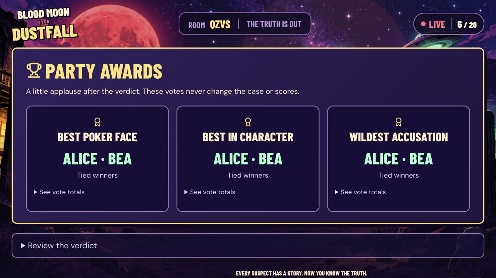

## Meet all twenty suspects

Public identities are safe to browse. Private dossiers go only to the assigned player in the running game. The [cast gallery](https://party.devicebytes.com/cast) has full public biographies, personalities and costume cues.

<table>
<tr>
<td align="center">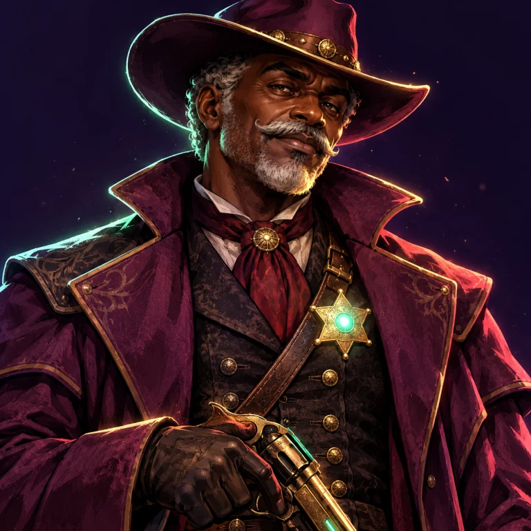<br><strong>Marshal Silas Vale</strong><br>The Weathered Marshal</td>
<td align="center"><br><strong>Jed Rattler</strong><br>The Borderland Courier</td>
<td align="center"><br><strong>Elias Thorne</strong><br>The Town Undertaker</td>
<td align="center"><br><strong>Reverend Gabriel Flint</strong><br>The Frontier Preacher</td>
<td align="center"><br><strong>Augustus Pike</strong><br>The Railroad Magnate</td>
</tr>
<tr>
<td align="center"><br><strong>Tobias Wren</strong><br>The Telegraph Prodigy</td>
<td align="center"><br><strong>Finch Mercer</strong><br>The Velvet Cardsharp</td>
<td align="center"><br><strong>Ambassador Orion Vex</strong><br>The Celestial Diplomat</td>
<td align="center"><br><strong>Keth Solaris</strong><br>The Starship Engineer</td>
<td align="center">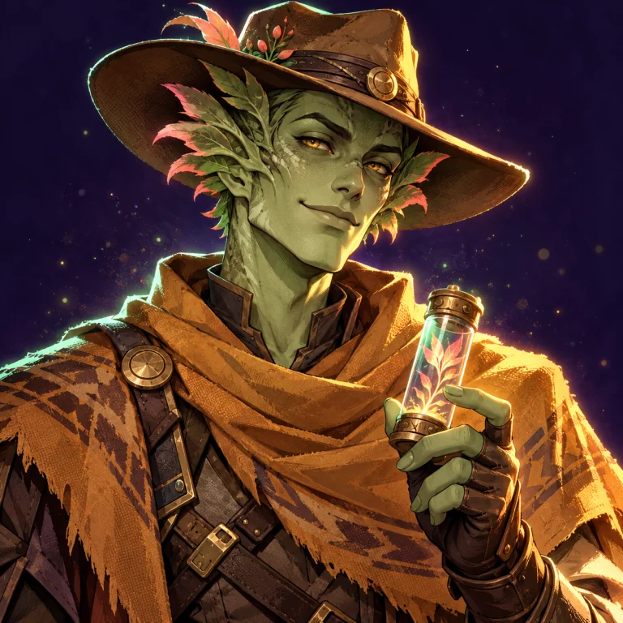<br><strong>Rowan Quill</strong><br>The Extraterrestrial Botanist</td>
</tr>
<tr>
<td align="center"><br><strong>Ada Crowe</strong><br>The Eclipse Proprietor</td>
<td align="center">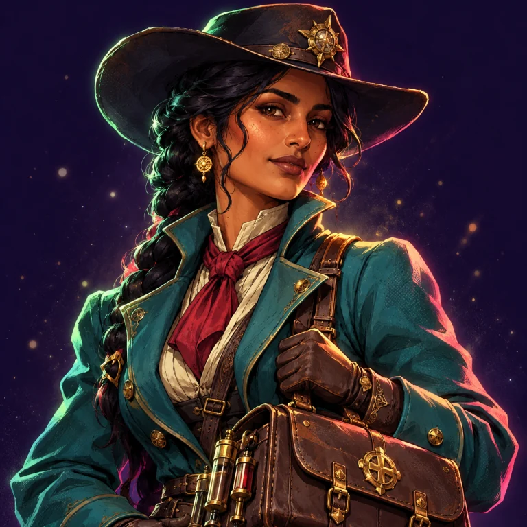<br><strong>Dr. Beatrice Bell</strong><br>The Frontier Physician</td>
<td align="center"><br><strong>Cassidy Blaze</strong><br>The Cinder Rancher</td>
<td align="center"><br><strong>Delphine Dusk</strong><br>The Midnight Illusionist</td>
<td align="center"><br><strong>Evelyn Sterling</strong><br>The Ink-Stained Reporter</td>
</tr>
<tr>
<td align="center"><br><strong>Florence Rook</strong><br>The Meteor Assayer</td>
<td align="center"><br><strong>Marigold Shaw</strong><br>The Rail Yard Mechanic</td>
<td align="center"><br><strong>Captain Lyra Nine</strong><br>The Fallen-Star Navigator</td>
<td align="center"><br><strong>Nyx Ash</strong><br>The Treaty Sentinel</td>
<td align="center">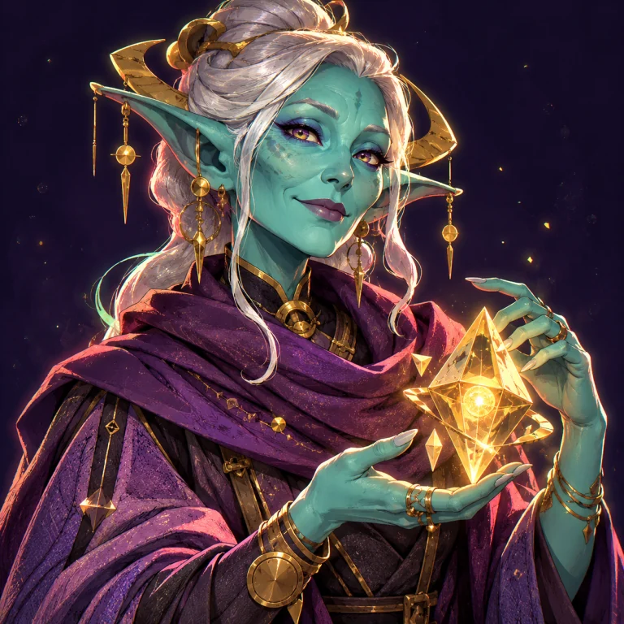<br><strong>Sera Lumen</strong><br>The Memory Archivist</td>
</tr>
</table>

## Real gameplay

These captures show the working site, separate from the design concepts below. Sample names are test guests; no recovery credentials or private dossiers appear.

| Twenty-character shared stage | Live sealed-vote participation |
| --- | --- |
| 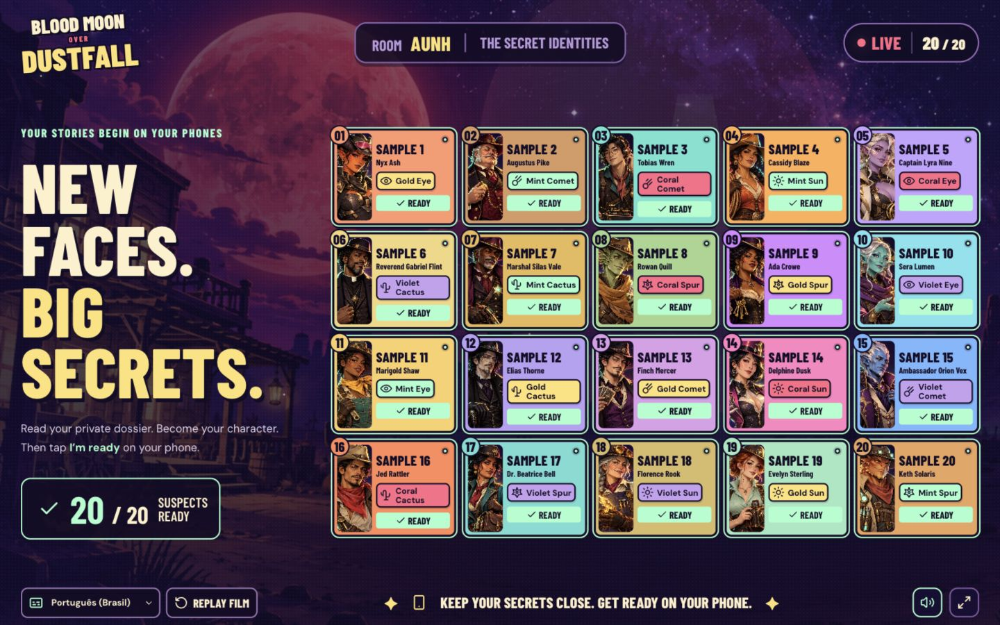 | 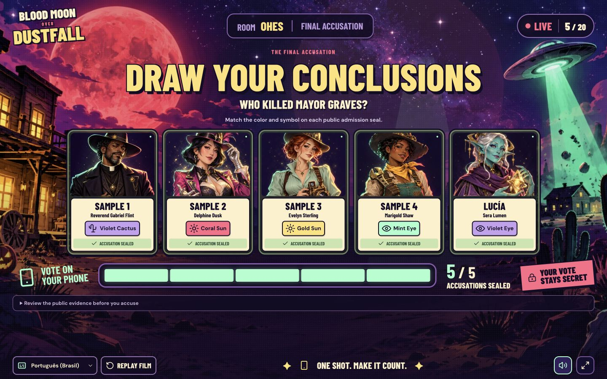 |

<p align="center">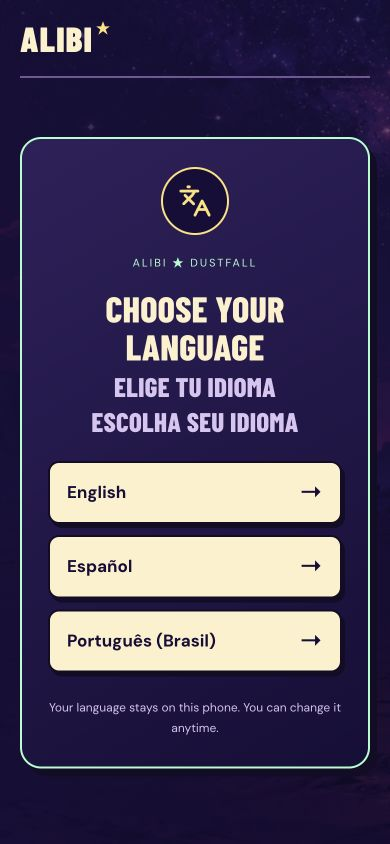</p>

| Everyone looks up together | The same moment on a Spanish phone |
| --- | --- |
| 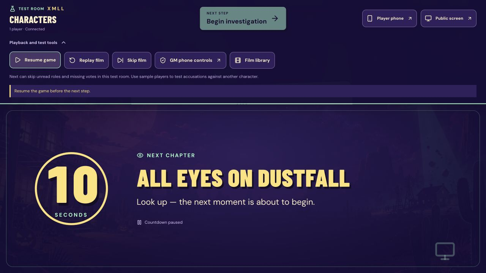 |  |

<details>
<summary>Actual arcade launch screen</summary>

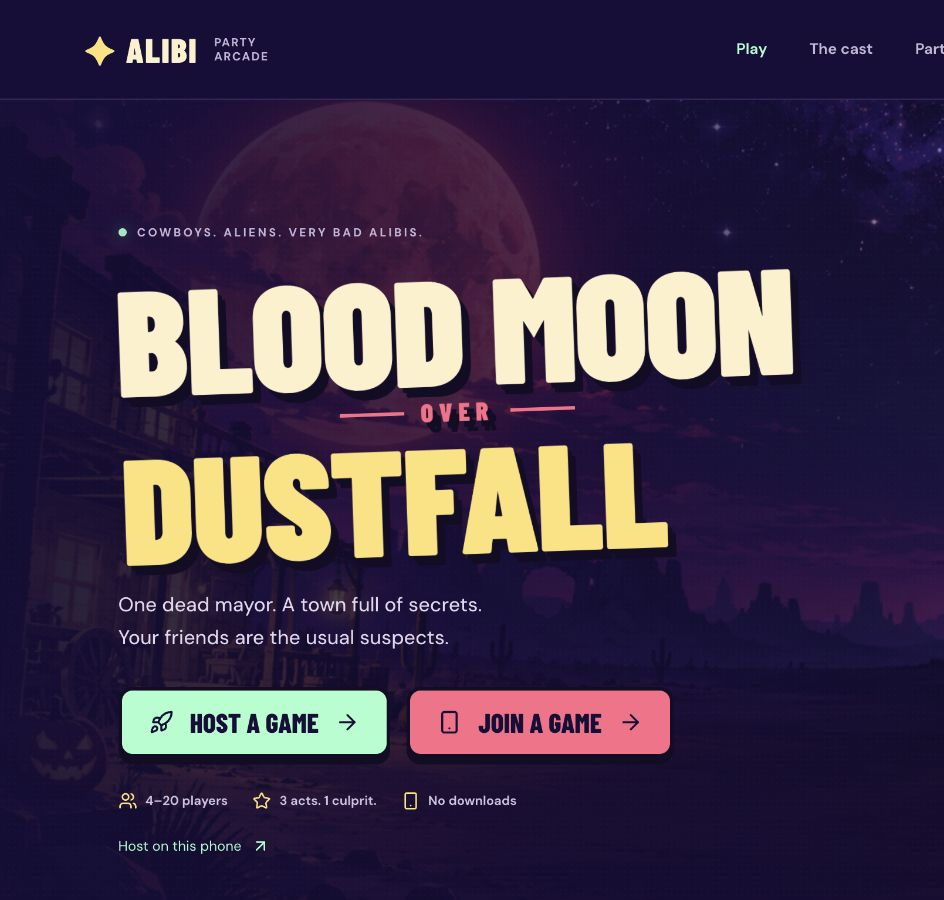

</details>

## Films, a Western narrator and live captions

**Eleven Higgsfield films** cover the opening, five act intros, a public clue event, voting and three endings. **Thirteen ElevenLabs announcements**, voiced by **Arthur — Engaging Southern Cowboy**, explain joining, roles, acts, evidence, voting and outcomes, and warn at thirty seconds. Existing recordings are generated ahead of play; guests need neither service.

[Watch the 18-second opening film](https://d2ol7oe51mr4n9.cloudfront.net/user_3Jbj3Eu3K5yyf4RJBsM47mX7Q3X/fda1f894-56ad-487d-81f7-0b71a1f7b02e.mp4), or open the [film library](https://party.devicebytes.com/films) for caption controls and transcripts. Its endings contain spoilers.

Speech is English; timed captions support **English, Spanish and Brazilian Portuguese**. Spanish/Portuguese phones enable silent live captions by default, following the TV’s actual film/narration clock independently of its caption language. Buffering, pause, replay, skip and stale connections retire or update that clock. Narration waits for film audio; a scoped media-only display lease coordinates one TV without giving it GM authority.

The stage supports sound, CC, local playback and fullscreen. The GM can pause, skip, replay or set TV captions from their phone. Completed/skipped films remain completed across display reloads. Native controls and spoken-text fallbacks keep the story usable during media outages. Reduced-motion preferences are honored.

[MEDIA.md](docs/MEDIA.md) describes the art, portraits, evidence props, concepts and media origins. Movie MP4s are hosted streams; narrator MP3s and VTT tracks are local assets.

<details>
<summary>Five AI-generated design concepts · visual exploration, not screenshots</summary>

The original concepts established the violet, mint, coral and parchment arcade direction. These are generated mockups; the real UI is pictured above.

| Lobby concept | Investigation concept |
| --- | --- |
| 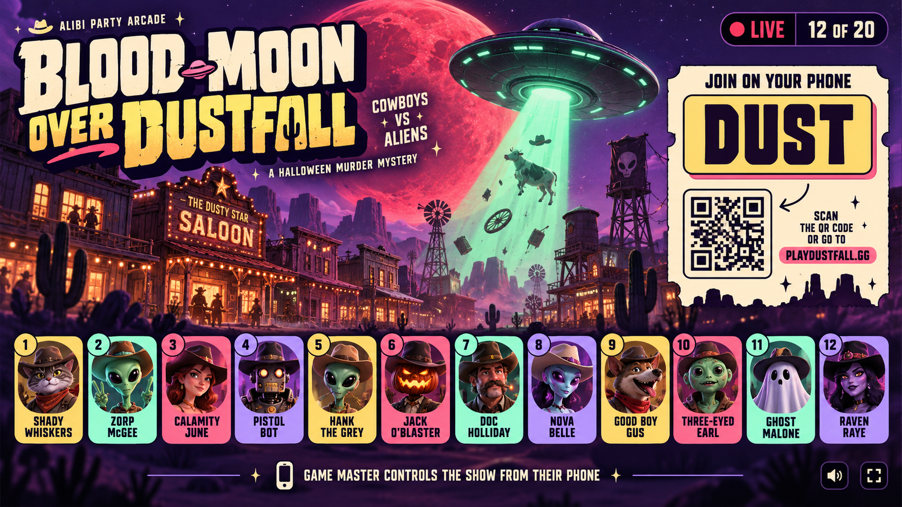 | 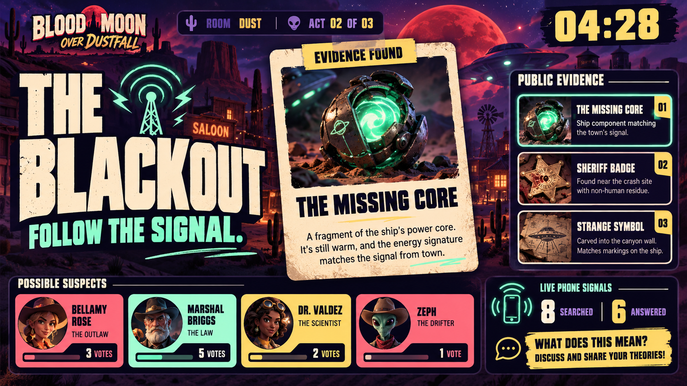 |

| Phone concept | Voting concept |
| --- | --- |
| 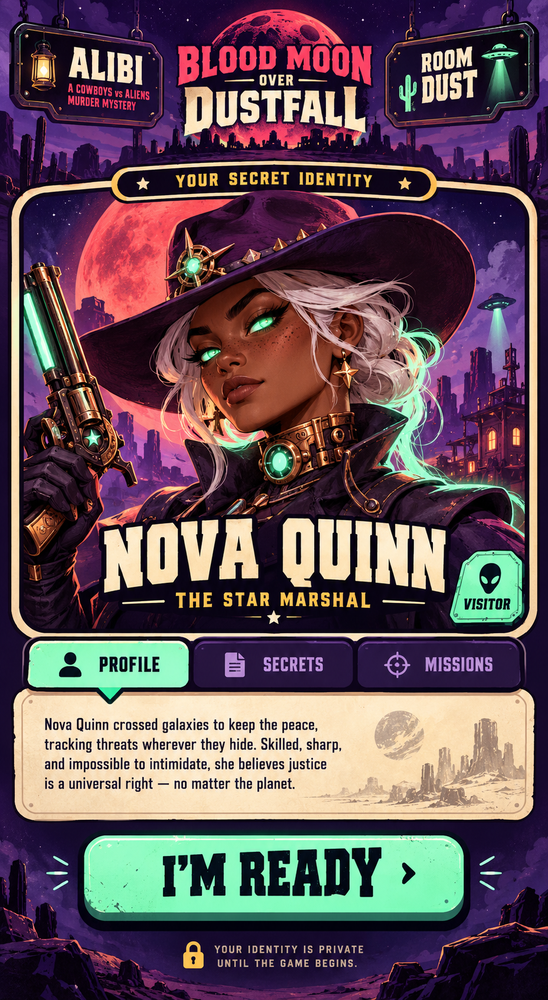 | 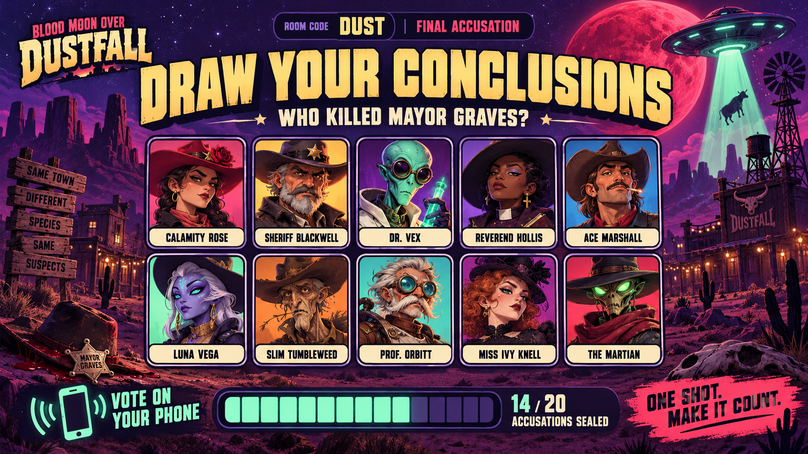 |

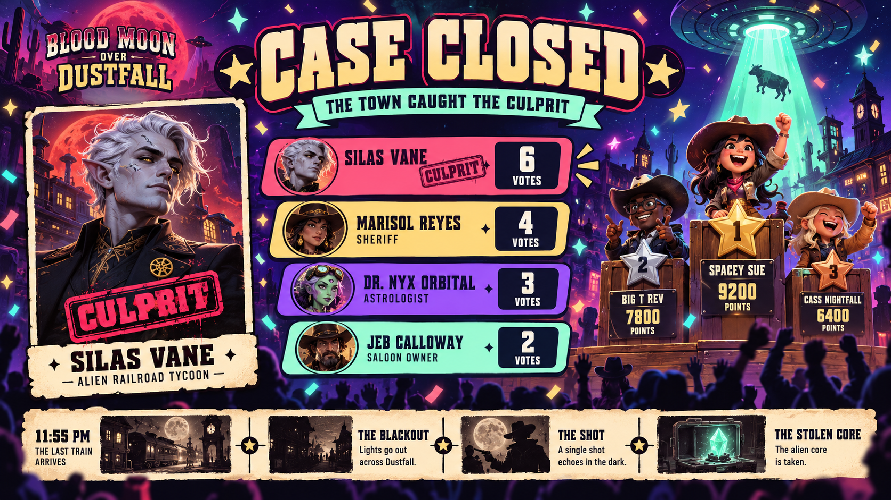

</details>

## Rejoining and a missing game master

Refresh, phone sleep, a dropped connection or **Step away** preserves the exact seat, character, clues, searches, answers, points and sealed vote. Same-browser saved games offer return links. Multiple tabs have separate presence leases. New guests join only in an unlocked lobby; authenticated returning guests can recover a full, locked or started room.

On a new device or cleared browser, use `/recover/CODE` with the private player/GM code. Recovery rotates access and invalidates old devices while retaining accepted gameplay. Lobby seats can be explicitly released; active-case characters stay for the whole mystery.

Everyone sees the named GM’s connection status. A GM can offer a two-minute handoff to one real guest. After sixty seconds without authenticated GM activity, the nominated—or automatically eligible—connected real player may confirm takeover. A returning GM cancels fallback before takeover; after transfer, the old controller cannot reclaim authority silently. Promoted players retain separate Player and GM sessions.

Presence expires after fifteen seconds without a device refresh. Rooms expire after twelve hours. If storage is blocked, access lasts for the current visit; keep the private recovery code before closing the browser. When all credentials/codes are lost and no eligible guest can take over, create a new room. See [the recovery scenario matrix](docs/PLAYER_RECOVERY.md).

## Test the whole game

Open [the developer rehearsal](https://party.devicebytes.com/dev) for an isolated **1–20-player** room with authenticated **Next step** controls on its public stage. One real player can run the complete loop. Add sample guests in the lobby to test accusations; a solo player has no self-vote target and can advance to an empty-ballot ending. Rehearsal mode grants no controls over ordinary party rooms.

For a realistic rehearsal, use a TV, the GM phone and four real or sample guests. Choose mixed languages, read roles, perform every act action, pause/resume, add time, leave/rejoin, seal votes, reveal and reset. Check that public counts update while vote choices remain private. **Take a test ride** adds clearly named samples that ready, search, answer, share, suspect and vote automatically.

[TESTING.md](docs/TESTING.md) has the full friends walkthrough. [PARTY_SCENARIOS.md](docs/PARTY_SCENARIOS.md) covers outages, simultaneous commands, stale confirmations, delayed responses, captions and recovery.

## Develop locally

Use **Node.js 24**. Node 22.12+ can run the app; the regression suite also uses Node 24’s SQLite support.

```sh
npm ci
npm run dev
```

Open [localhost:3000](http://localhost:3000). The terminal prints a LAN URL for physical phones. Local rooms live in memory and disappear on server restart; source changes under `npm run dev` intentionally restart it. For an uninterrupted local rehearsal:

```sh
npm test
npm run build
PORT=3001 npm start
```

`npm run build` produces `.web-dist/`, packages the app/backend as one Worker at `dist/server/index.js`, validates its shell and typechecks. Private Sites metadata is copied only when present, so public clones build without it. `npm run typecheck` runs TypeScript independently.

With a server running, HTTP regressions create disposable rooms and report safe status/counts:

```sh
node scripts/verify-online.mjs http://localhost:3001
node scripts/verify-languages.mjs http://localhost:3001
node scripts/verify-extra-minute.mjs http://localhost:3001
node scripts/verify-recovery.mjs http://localhost:3001
node scripts/verify-rehearsal.mjs http://localhost:3001
node scripts/verify-scenarios.mjs http://localhost:3001
node scripts/verify-attention.mjs http://localhost:3001
node scripts/verify-party-features.mjs http://localhost:3001
```

## Architecture and deployment

| Layer | Responsibility |
| --- | --- |
| `src/` | React/Vite, phone controllers, public stage, localization, countdowns and media |
| `shared/characters.ts` | Public cast and portrait references |
| `server/engine.ts` | Authoritative rules and serializable room state |
| `server/story.ts`, `server/locales/` | Private dossiers, clues, questions, translations and solutions; never browser imports |
| `online/service.ts`, `online/rpc.ts` | Viewer filtering, recovery, pairing, presence, authenticated commands and retry receipts |
| `online/repository.ts` | Memory/D1 repositories with revision-based compare-and-swap writes |
| `online/worker.ts`, `drizzle/` | Hosted HTTPS API, embedded assets and schema-only D1 migrations |
| `public/media/`, `shared/media-sync.ts` | Film/narration manifests, three-language cues and the public playback clock |

**Spoilers for code readers:** `server/story.ts`, `server/locales/` and [`docs/story/`](docs/story/) contain private information and the solution. Browse the public cast if you intend to play unspoiled.

Hosted rooms use the existing Sites Worker and D1. Visible devices poll about once a second; concurrent mutations retry against current revisions. Commands include the viewed game step and stable receipts, preventing retries or stale controllers from advancing a later step. Private credentials travel in HTTPS JSON bodies; short-lived pairing tickets use fragments cleared on arrival.

The **Vercel production site is live at [party.devicebytes.com](https://party.devicebytes.com)**. [`vercel.json`](vercel.json) publishes `.web-dist/` and forwards room operations to the existing Sites API; `api/config.mjs` returns the current frontend origin, so room invitations and both player and private GM pairing QRs stay on the domain you opened. There is no second database. The original [Vercel address](https://blood-moon-dustfall.vercel.app) and Sites address remain available without forcing existing games onto a new origin. Use `party.devicebytes.com` on the TV and every phone for a new game. Browser-saved identities are origin-scoped; use a private recovery code when moving an existing identity between domains. See [VERCEL.md](docs/VERCEL.md).

Public source: [PhilPNG/blood-moon-dustfall](https://github.com/PhilPNG/blood-moon-dustfall). `node scripts/stage-public.mjs` creates the ignored `.public-release/` export while preserving its Git history. Its allowlist includes playable source, art/media, reviewed screenshots and docs. It excludes private hosting metadata, consent records, operational/billing logs, runtime databases, bundles and dependencies. `scripts/stage-release.mjs` remains the separate private Sites source workflow. Staging does not publish or deploy.
